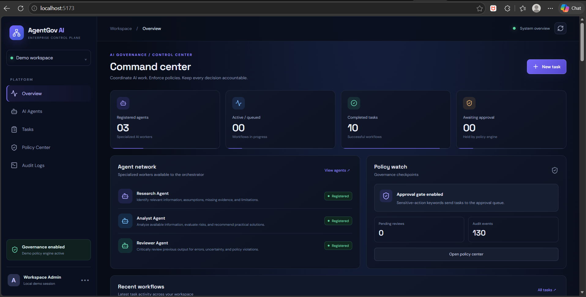
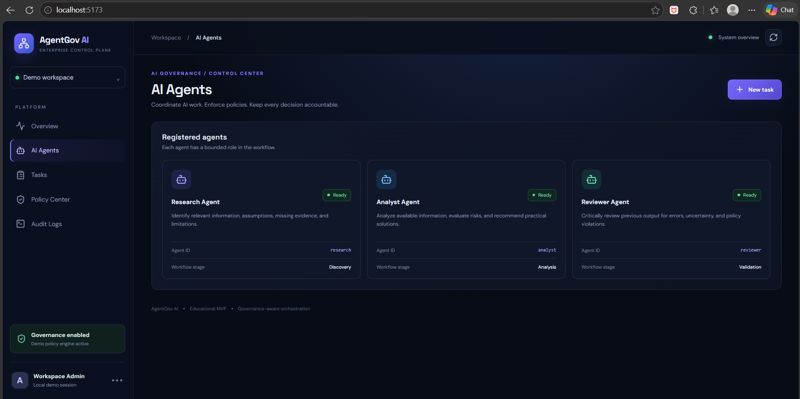
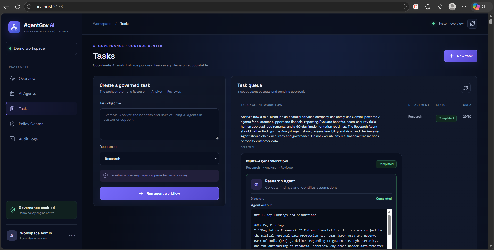
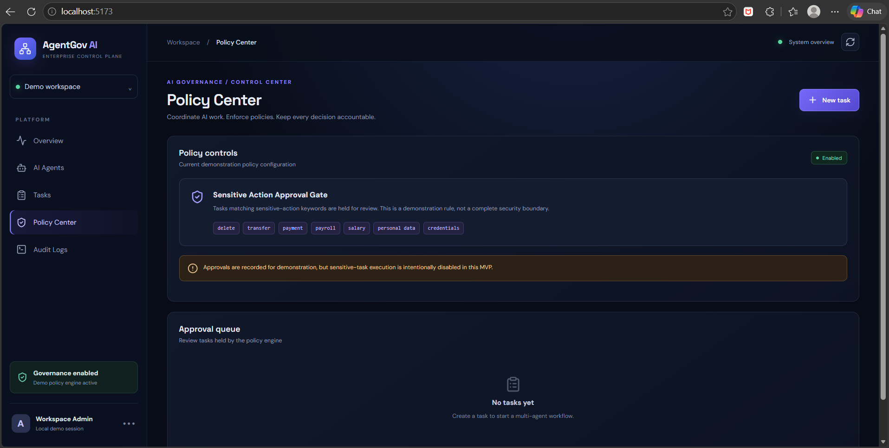
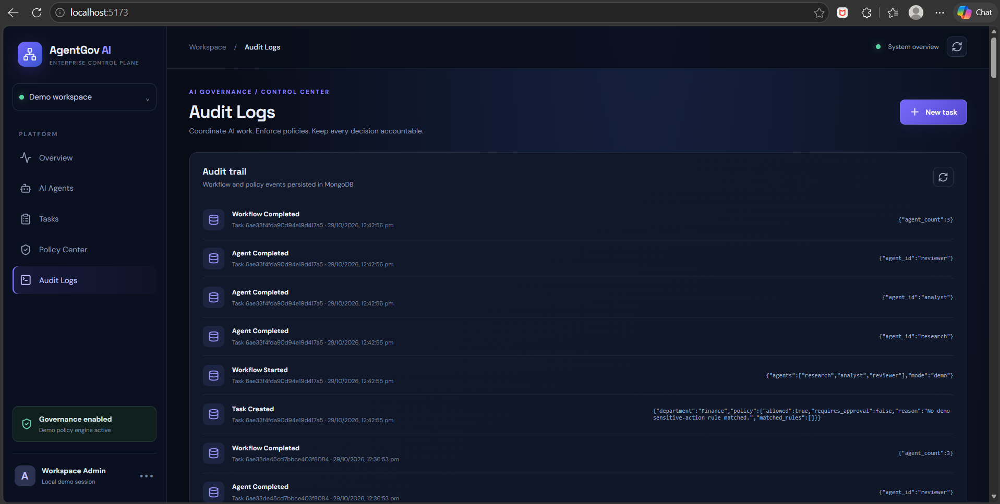
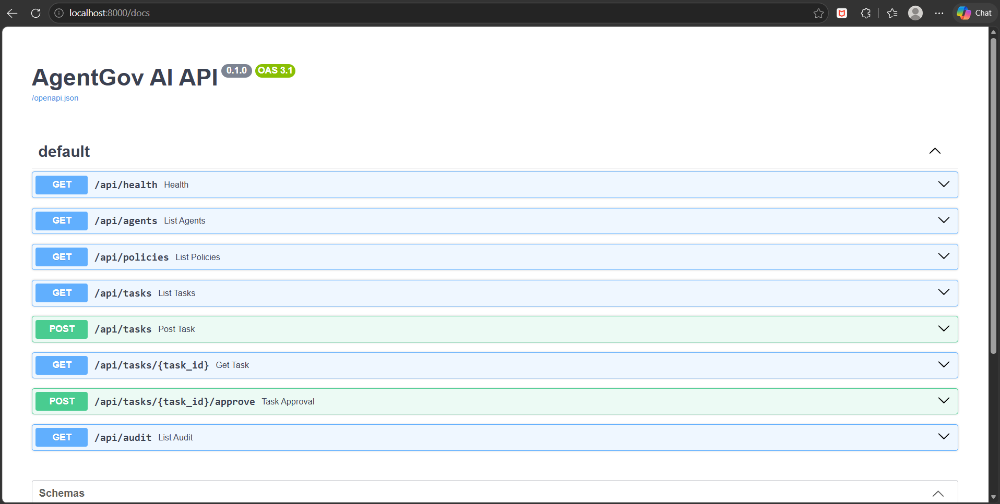

# AgentGov AI — Multi-Agent AI Governance Platform

An AI-powered governance platform that uses multiple specialized agents to research tasks, analyze results, review policy compliance, and support human approval through an auditable workflow.

## 🏠 Project Overview

AgentGov AI combines a React + TypeScript frontend with a FastAPI backend and MongoDB Atlas persistence to demonstrate how multi-agent AI workflows can be managed with policy checks, human oversight, and audit logging.

**Key workflow:** Research Agent → Analyst Agent → Reviewer Agent → Human Approval

## ✨ Features

- 🤖 **Multi-Agent AI Workflow** — Separate Research, Analyst, and Reviewer agents.
- 🔍 **Research & Analysis** — Process user-submitted tasks through a coordinated AI workflow.
- 🛡️ **Policy Checks** — Demonstration-level checks before tasks proceed.
- 👤 **Human Approval Queue** — Review and approve eligible tasks.
- 📜 **Audit Events** — Track workflow activity and governance-related events.
- 🗄️ **MongoDB Atlas** — Persistent storage for application data.
- ⚡ **REST API** — FastAPI endpoints for tasks, agents, policies, and audit records.
- 🖥️ **Interactive Dashboard** — React, TypeScript, and Vite frontend.
- 🔑 **Environment-Based Configuration** — Store API keys and database configuration in environment variables.

## 🖼️ Project Screenshots

> Add your actual AgentGov AI screenshots to the repository's `screenshots/` folder, then update the image paths below.

### 1. Main Dashboard



### 2. AI Agents



### 3. Task Management



### 4. Human Approval Queue



### 5. Audit Logs



### 6. API Documentation



## 🧰 Tech Stack

| Component | Technology |
|---|---|
| Frontend | React, TypeScript, Vite |
| Backend | Python, FastAPI |
| Database | MongoDB Atlas |
| AI Integration | Google Gemini API |
| API Documentation | FastAPI / Swagger UI |
| Development Tools | Git, GitHub, VS Code |

*The AI integration above reflects the current Gemini configuration. Update it if the project changes providers.*

## 📂 Project Structure

```text
AgentGov-AI/
├── backend/
│   ├── app/
│   │   ├── main.py
│   │   ├── agents.py
│   │   └── config.py
│   ├── .env.example
│   └── requirements.txt
├── frontend/
│   ├── src/
│   ├── public/
│   ├── package.json
│   └── .env.example
├── screenshots/
│   ├── dashboard.png
│   ├── agents.png
│   ├── tasks.png
│   ├── approval-queue.png
│   ├── audit-logs.png
│   └── api-docs.png
└── README.md
```

*This is an illustrative structure; keep only paths that exist in your repository.*

## ⚙️ Requirements

- Python 3.11+
- Node.js 20+
- npm
- MongoDB Atlas account and connection string
- Google Gemini API key

## 🚀 Installation

### 1. Clone the Repository

```bash
git clone <YOUR_GITHUB_REPOSITORY_URL>
cd agentgov-ai-starter
```

### 2. Configure the Backend

Open PowerShell in the backend directory:

```powershell
cd backend
py -m venv .venv
.\.venv\Scripts\Activate.ps1
pip install -r requirements.txt
Copy-Item .env.example .env
```

Open `backend/.env` and configure your environment variables using the names expected by `app/config.py`:

```env
MONGODB_URI=your_mongodb_atlas_connection_string
MONGODB_DB=agentgov
GEMINI_API_KEY=your_gemini_api_key
```

Use the database name and variable names expected by your actual configuration. Never commit your real `.env` file or API keys to GitHub.

### 3. Start the Backend

From the `backend/` directory, run:

```powershell
uvicorn app.main:app --reload --port 8000
```

Backend API:

- Health check: http://localhost:8000/api/health
- Interactive API docs: http://localhost:8000/docs

### 4. Configure the Frontend

Open a second PowerShell terminal:

```powershell
cd frontend
npm install
Copy-Item .env.example .env
npm run dev
```

Open the Vite URL shown in the terminal, usually:

http://localhost:5173

## 🔌 API Endpoints

| Method | Endpoint | Purpose |
|---|---|---|
| GET | `/api/health` | Check backend health |
| GET | `/api/agents` | List available agents |
| GET | `/api/tasks` | Retrieve tasks |
| POST | `/api/tasks` | Create and process a task |
| GET | `/api/tasks/{task_id}` | Retrieve a task |
| POST | `/api/tasks/{task_id}/approve` | Submit an approval action |
| GET | `/api/policies` | Retrieve policy information |
| GET | `/api/audit` | Retrieve audit events |

## 🔄 How It Works

1. **Submit a task:** A user creates a task through the dashboard.
2. **Research Agent:** Gathers relevant information for the task.
3. **Analyst Agent:** Evaluates the collected information and prepares analysis.
4. **Reviewer Agent:** Reviews the workflow output and applies demonstration-level policy checks.
5. **Human approval:** Eligible tasks can be reviewed by a human before proceeding.
6. **Audit logging:** Workflow activity is recorded for inspection.

## 🛡️ Safety and Limitations

AgentGov AI is an educational MVP, not a production-ready governance or security system.

Before deploying in a real organization, implement authenticated identities, server-enforced role-based access control, tenant isolation, rate limiting, secure secret management, robust prompt-injection defenses, and reliable human approval records.

Do not give AI agents unrestricted tools or direct access to sensitive credentials.

## 🌐 Deployment

Potential deployment options include:

- **Frontend:** Vercel or Netlify
- **Backend:** Render or Railway
- **Database:** MongoDB Atlas

Configure environment variables securely on your hosting platform before deployment.

## 👨‍💻 Author

**Neelesh Ranpuriya**

AI & Data Science Student at MITS Gwalior

Interests: Artificial Intelligence, Multi-Agent Systems, Generative AI, Data Analytics, and Full-Stack Development.

## 📄 License

Add a `LICENSE` file to specify how others may use, modify, and distribute this project.